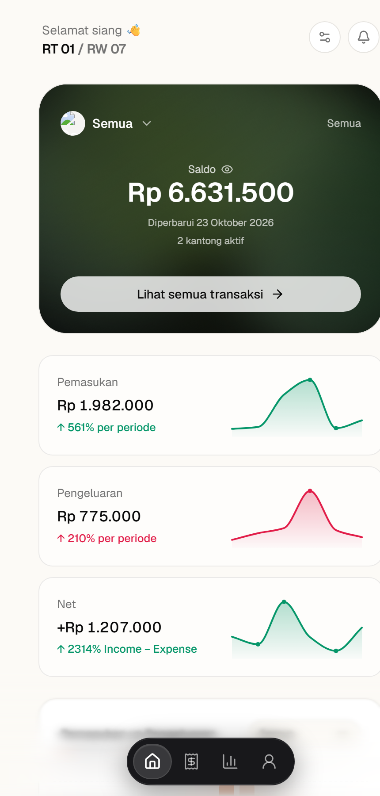
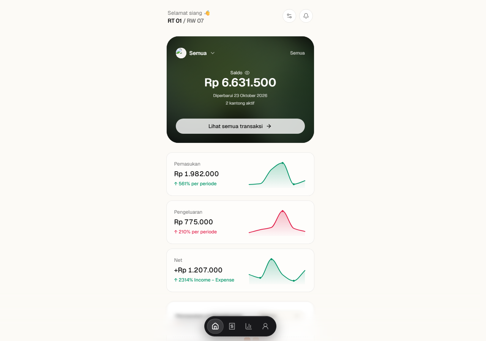

# RT Finance (Kompak)

Aplikasi pencatatan keuangan RT berbasis web: kas multi-kantong, transaksi harian, laporan bulanan (PDF & Excel), import Excel, pencatatan lewat AI, dan bot Telegram. Tampilan mobile-first (PWA) dengan dua peran pengguna: **admin/bendahara** (baca-tulis) dan **viewer** (baca saja).

Dibangun dengan **Next.js 16 (App Router)**, **TypeScript**, **Tailwind CSS v4**, dan **Supabase** (Postgres + Auth + Storage).

---

## Screenshot

<p align="center">
  
</p>

<details>
<summary>Lihat versi desktop</summary>



</details>

---

## Daftar Isi

- [Screenshot](#screenshot)
- [Fitur](#fitur)
- [Prasyarat](#prasyarat)
- [1. Setup Supabase](#1-setup-supabase)
- [2. Environment Variables](#2-environment-variables)
- [3. Install & Jalankan Lokal](#3-install--jalankan-lokal)
- [4. Akses Admin (Login)](#4-akses-admin-login)
- [5. Panduan Pemakaian](#5-panduan-pemakaian)
- [6. Integrasi Supabase](#6-integrasi-supabase)
- [7. Integrasi Bot Telegram](#7-integrasi-bot-telegram)
- [8. API Routes](#8-api-routes)
- [9. Deploy ke Vercel](#9-deploy-ke-vercel)
- [10. Troubleshooting](#10-troubleshooting)
- [Struktur Project](#struktur-project)
- [Scripts](#scripts)
- [Lisensi](#lisensi)

---

## Fitur

| Fitur | Keterangan |
| --- | --- |
| Dashboard | Total saldo, saldo per kantong, pemasukan/pengeluaran (hari ini, bulan ini, tahun ini), grafik 6 bulan, transaksi terbaru |
| Transaksi | Catat pemasukan/pengeluaran, edit, hapus, filter, dan transfer antar kantong |
| Kantong (pockets) | Kelola kantong kas (Kas, BOP, Sosial, Kegiatan, dll), warna/gradient, saldo awal, dan laporan per kantong |
| Laporan | Rekap bulanan per kantong, ekspor PDF & Excel, arsip laporan tersimpan di Supabase Storage |
| Import Excel | Import transaksi massal dari file `.xlsx` memakai template resmi |
| Smart Input (AI) | Tulis transaksi dengan bahasa bebas, mis. "beli konsumsi 75 ribu dari kas" |
| Bot Telegram | Catat transaksi & cek saldo/laporan dari Telegram, terhubung lewat kode linking |
| Pengaturan | Kantong, tampilan/tema, provider AI, koneksi Telegram, dan status storage |
| PWA | Bisa dipasang ke home screen (manifest + ikon) |

---

## Prasyarat

- **Node.js 20.9+** (disarankan 22 LTS) dan npm
- Project **Supabase** (cloud atau lokal)
- Opsional: **Supabase CLI** (untuk push migrasi), **Git**, akun **Vercel** (deploy), bot **Telegram** (integrasi)

---

## 1. Setup Supabase

### 1.1 Buat project

1. Buka [supabase.com/dashboard](https://supabase.com/dashboard) → **New project**.
2. Setelah project selesai dibuat, buka **Project Settings → API**, catat:
   - **Project URL** → `NEXT_PUBLIC_SUPABASE_URL`
   - **anon / publishable key** → `NEXT_PUBLIC_SUPABASE_ANON_KEY`
   - **service_role / secret key** → `SUPABASE_SERVICE_ROLE_KEY` (jangan pernah dipakai di browser)

### 1.2 Jalankan migrasi database

Semua skema ada di `supabase/migrations/`. **Jalankan berurutan dari `001` sampai `018`.**

| File | Isi |
| --- | --- |
| `001_initial_schema.sql` | Tipe enum, tabel inti (`rt_profiles`, `profiles`, `pockets`, `categories`, `transactions`, `transfers`, `transaction_attachments`), view saldo, RLS |
| `002_seed_dev.sql` | Seed RT contoh + kantong + kategori (UUID tetap untuk dev) |
| `003_telegram.sql` | Tabel & kolom integrasi Telegram |
| `004_pocket_opening_balance.sql` | Saldo awal kantong |
| `005_ai_settings.sql` | Pengaturan provider AI per RT |
| `006_relax_transaction_category.sql` | Kategori transaksi opsional |
| `007_monthly_reports.sql` | Arsip laporan bulanan |
| `008_add_pocket_to_monthly_reports.sql` | Laporan per kantong |
| `009_add_gemini_provider.sql` | Provider Gemini |
| `010_telegram_edit.sql` | Edit transaksi dari Telegram |
| `011`–`014`, `017` | Gradient/tema kartu kantong & tampilan |
| `012_appearance.sql` | Pengaturan tampilan |
| `015_viewer_read_policies.sql` | Policy baca untuk role viewer |
| `016_pocket_balances_gradient.sql` | Saldo + gradient per kantong |
| `018_telegram_report_period.sql` | Periode kustom laporan Telegram |

**Opsi A — SQL Editor (paling mudah)**

1. Supabase Dashboard → **SQL Editor** → **New query**.
2. Copy-paste isi `001_initial_schema.sql`, klik **Run**.
3. Ulangi untuk `002`, `003`, … `018` sesuai urutan.

**Opsi B — Supabase CLI**

```bash
# dari root project
npx supabase login
npx supabase link --project-ref <PROJECT_REF>
npx supabase db push
```

**Opsi C — psql**

```bash
psql "<DATABASE_URL>" -f supabase/migrations/001_initial_schema.sql
psql "<DATABASE_URL>" -f supabase/migrations/002_seed_dev.sql
# ... lanjutkan 003 s/d 018
```

> **Catatan `DEV_RT_ID`**
> `002_seed_dev.sql` membuat RT dengan UUID tetap `00000000-0000-4000-a000-000000000001`. Nilai ini sama dengan `DEV_RT_ID` di `src/lib/env.ts` dan dipakai sebagai fallback ketika belum ada sesi login. **Jangan mengubah UUID ini** kecuali Anda ikut menyesuaikan kode/env. Untuk RT lain, buat baris `rt_profiles` baru lalu hubungkan user lewat kolom `profiles.rt_id`.

### 1.3 Buat user admin

Supabase **tidak** membuat baris `profiles` secara otomatis. Setelah user dibuat, Anda **wajib** menambahkan baris di tabel `profiles` agar role-nya terbaca.

1. Dashboard → **Authentication → Users → Add user** → isi email & password.
   - Aktifkan **Auto Confirm User** (atau klik link konfirmasi di email) supaya bisa langsung login.
2. Copy **UUID user** tersebut.
3. Jalankan di SQL Editor:

```sql
insert into public.profiles (id, rt_id, name, role)
values (
  '<UUID_USER_DARI_AUTH>',
  '00000000-0000-4000-a000-000000000001', -- rt_id hasil seed
  'Admin RT 01',
  'admin'                                  -- 'admin' | 'bendahara' | 'viewer'
);
```

Role yang tersedia:

| Role | Hak akses |
| --- | --- |
| `admin` | Baca + tulis, akses penuh ke Pengaturan |
| `bendahara` | Baca + tulis (tanpa akses khusus admin lain) |
| `viewer` | Baca saja; **ditolak** di halaman login admin |

> Tanpa baris `profiles`, akun tetap bisa login, tetapi role terbaca `null` sehingga diperlakukan seperti viewer dan tidak bisa membuka `/pengaturan` atau membuat transaksi.

### 1.4 Storage untuk laporan

Laporan bulanan disimpan di bucket **`monthly-reports`** (private). Bucket dibuat otomatis oleh server saat laporan pertama kali digenerate menggunakan `service_role`. Jika pembuatan otomatis gagal (mis. izin terbatas), buat manual:

1. Dashboard → **Storage → New bucket** → nama `monthly-reports`, **Public: off**.
2. File diakses lewat **signed URL** (kode sudah menanganinya).

### 1.5 Keamanan & RLS

- Kunci `service_role` **hanya** boleh ada di environment server (Vercel/host), tidak pernah di kode client.
- RLS aktif di semua tabel. Policy baca untuk `viewer` ada di migrasi `015`.
- Halaman publik memang dapat diakses **tanpa login** (by design) agar warga mudah melihat saldo dan laporan. Halaman tulis tetap dijaga role `admin`/`bendahara`. Jika data RT bersifat sensitif, tambahkan auth di depan dashboard atau batasi deployment-nya.

---

## 2. Environment Variables

Salin contoh lalu isi nilainya:

```bash
cp .env.example .env.local        # macOS / Linux
Copy-Item .env.example .env.local # Windows PowerShell
```

Isi minimal:

```env
NEXT_PUBLIC_SUPABASE_URL=https://xxxx.supabase.co
NEXT_PUBLIC_SUPABASE_ANON_KEY=eyJ...
SUPABASE_SERVICE_ROLE_KEY=eyJ...
NEXT_PUBLIC_APP_URL=http://localhost:3000
```

Referensi lengkap:

| Variabel | Wajib | Kegunaan |
| --- | --- | --- |
| `NEXT_PUBLIC_SUPABASE_URL` | ✅ | URL project Supabase |
| `NEXT_PUBLIC_SUPABASE_ANON_KEY` | ✅ | Key publik untuk Supabase Auth di browser |
| `SUPABASE_SERVICE_ROLE_KEY` | ✅ (disarankan) | Akses server-side untuk data, storage, dan webhook (bypass RLS) |
| `NEXT_PUBLIC_APP_URL` | ⬜ | Base URL aplikasi (link Telegram, redirect) |
| `CRON_SECRET` | ⬜ | Proteksi endpoint cron laporan bulanan |
| `AI_PROVIDER` | ⬜ | `openrouter` \| `openai` \| `anthropic` \| `gemini` \| `mock` |
| `OPENROUTER_API_KEY` / `OPENROUTER_MODEL` | ⬜ | Provider default untuk Smart Input & bot |
| `OPENAI_API_KEY`, `ANTHROPIC_API_KEY` | ⬜ | Provider alternatif |
| `GEMINI_API_KEY` / `GEMINI_MODEL`, `GOOGLE_API_KEY` | ⬜ | Provider Google |
| `TELEGRAM_BOT_TOKEN` | ⬜ | Token bot dari [@BotFather](https://t.me/BotFather) |
| `TELEGRAM_WEBHOOK_SECRET` | ⬜ | Secret header webhook Telegram |

> AI bisa juga dikonfigurasi per RT lewat halaman **Pengaturan → AI & Telegram** (disimpan di tabel `rt_ai_settings`). Nilai env dipakai sebagai fallback.

---

## 3. Install & Jalankan Lokal

```bash
git clone https://github.com/satrioa/RT01.git
cd RT01

npm install          # .npmrc sudah menyetel legacy-peer-deps=true
Copy-Item .env.example .env.local   # lalu isi nilainya

npm run dev
```

Buka **http://localhost:3000**.

Perintah lain:

```bash
npm run build      # build produksi
npm run start      # jalankan hasil build
npm run lint       # ESLint
npm run typecheck  # TypeScript tanpa emit
npm test           # unit test (Vitest)
```

---

## 4. Akses Admin (Login)

| URL | Fungsi |
| --- | --- |
| `/admin/login` | Halaman form login admin |
| `/admin` | Guard: jika belum login → redirect ke `/admin/login`; jika sudah → redirect ke `/` |

Alur login:

1. Buka `http://localhost:3000/admin/login`.
2. Masukkan email & password user Supabase Auth.
3. Sistem mengecek role di tabel `profiles`.
   - Role `viewer` → login ditolak dengan pesan *"Akun Anda tidak memiliki akses admin."*
   - Role `admin` / `bendahara` → sesi disimpan ke cookie `sb-<ref>-auth-token`, lalu redirect ke dashboard `/`.
4. Halaman yang butuh hak tulis (mis. `/transactions/new`, `/import`, `/pengaturan`) akan me-redirect pengguna tanpa hak tulis.

Catatan:

- Sesi berlaku 7 hari (cookie `SameSite=Lax`).
- Logout lewat menu **Akun** (`/akun`) → **Keluar**. Jika perlu, cookie `sb-<project-ref>-auth-token` juga bisa dihapus manual di browser (DevTools → Application → Cookies).
- **Penting:** login berhasil tetapi tetap tidak bisa mengubah data? Hampir selalu karena baris `profiles` belum dibuat atau `role` masih `viewer` — lihat [1.3](#13-buat-user-admin).

---

## 5. Panduan Pemakaian

| Route | Akses | Fungsi |
| --- | --- | --- |
| `/` | semua | Dashboard: total saldo, kartu kantong, KPI, grafik, transaksi terbaru, Smart Input |
| `/transactions` | semua (viewer read-only) | Daftar transaksi + filter periode/kantong/kategori |
| `/transactions/new` | admin/bendahara | Tambah pemasukan/pengeluaran; tab transfer antar kantong |
| `/transactions/[id]` | semua | Detail transaksi |
| `/transactions/[id]/edit` | admin/bendahara | Edit transaksi |
| `/pockets/[id]` | semua | Detail kantong, saldo, riwayat, laporan bulanan kantong |
| `/reports` | semua | Daftar/ringkasan laporan bulanan |
| `/reports/[year]/[month]` | semua | Laporan detail per bulan (filter kantong, unduh PDF/Excel) |
| `/import` | admin/bendahara | Import transaksi dari Excel |
| `/pengaturan` | admin/bendahara | Kantong, tampilan, AI, Telegram, storage |
| `/transaksi`, `/laporan` | semua | Alias lama yang me-redirect ke `/transactions` & `/reports` |

**Alur singkat**

1. **Login** di `/admin/login` (lihat bagian 4).
2. **Atur kantong** di `/pengaturan` (nama, ikon, warna/gradient, saldo awal).
3. **Catat transaksi** lewat tombol **+** di navigasi bawah, atau ketik bebas di **Smart Input** pada dashboard.
4. **Cek laporan** di `/reports` → pilih bulan → unduh **PDF** atau **Excel**.
5. **Import massal**: `/import` → unduh template (`/api/template/import`) → isi → unggah.
6. **Hubungkan Telegram** di `/pengaturan` → **AI & Telegram** → *Generate Kode Linking* → kirim `/link KODE` ke bot.
7. **Terapkan tema** di `/pengaturan` → bagian Tampilan.

**Format transaksi via Smart Input / Telegram** (contoh):

```
Beli konsumsi 75 ribu dari Kas
Iuran warga 200.000 masuk ke Kas
Pindah 100 ribu dari BOP ke Sosial
```

---

## 6. Integrasi Supabase

### 6.1 Arsitektur

```
Browser (React 19 / Next App Router)
   │  server actions & route handlers
   ▼
Next.js server (Node runtime)
   │  @supabase/supabase-js
   ├─────────────► Supabase Auth        (email + password, sesi cookie)
   ├─────────────► Supabase Postgres    (rt_profiles, profiles, pockets, ... + RLS)
   └─────────────► Supabase Storage     (bucket monthly-reports, signed URL)
```

### 6.2 Client Supabase di project

| File | Client | Dipakai untuk |
| --- | --- | --- |
| `src/lib/supabase/client.ts` | anon key (browser) | Login, baca data publik, `syncAuthToCookies()` |
| `src/lib/supabase/server.ts` | service role (fallback anon) | Server components & server actions |
| `src/lib/supabase/service.ts` | service role | Webhook Telegram, cron, generate laporan, bypass RLS |

### 6.3 Alur autentikasi

1. Login memakai `supabase.auth.signInWithPassword()` di browser.
2. Sesi disalin ke cookie `sb-<project-ref>-auth-token` (base64) oleh `syncAuthToCookies()` supaya server bisa membacanya.
3. `src/lib/auth.ts` membaca cookie tersebut, memvalidasi token ke Supabase, lalu mengambil `profiles.rt_id` & `profiles.role`.
4. Jika tidak ada sesi valid, aplikasi memakai `DEV_RT_ID` sebagai RT default (mode pengembangan).

Fungsi penting di `src/lib/auth.ts`: `getCurrentRtId()`, `getCurrentUserRole()`, `getAuthRtId()`, `requireWriteRole()`.

### 6.4 Multi-tenant

Semua data dikunci oleh `rt_id`. Satu database bisa menampung banyak RT:

- `rt_profiles` — identitas RT
- `profiles` — user aplikasi (`id` = `auth.users.id`, `rt_id`, `role`)
- `pockets`, `categories`, `transactions`, `transfers`, `monthly_reports`, `rt_ai_settings`, `rt_appearance_settings`, tabel Telegram — semuanya ber-`rt_id` dan dilindungi RLS.

### 6.5 Menambah migrasi baru

1. Buat file baru bernomor urut, mis. `supabase/migrations/019_nama_fitur.sql`.
2. Tulis SQL idempoten (`create table if not exists`, `drop policy if exists` sebelum `create policy`).
3. Jalankan di SQL Editor / `supabase db push`.
4. Sertakan perubahan tipe di `src/types/database.ts`.

---

## 7. Integrasi Bot Telegram

1. Buat bot via [@BotFather](https://t.me/BotFather), copy token ke `TELEGRAM_BOT_TOKEN`.
2. Set `TELEGRAM_WEBHOOK_SECRET` (string acak).
3. Daftarkan webhook (sekali saja):

```bash
curl "https://api.telegram.org/bot<TOKEN>/setWebhook?url=https://<DOMAIN_ANDA>/api/telegram/webhook&secret_token=<TELEGRAM_WEBHOOK_SECRET>"
```

4. Di aplikasi: **Pengaturan → AI & Telegram → Generate Kode Linking**.
5. Kirim `/link <KODE>` ke bot (kode berlaku 15 menit, sekali pakai).

Perintah bot:

| Perintah | Fungsi |
| --- | --- |
| `/start`, `/help` | Sapaan & bantuan |
| `/saldo` atau `/saldo kas` | Cek saldo tanpa AI |
| `/transaksi` | 5 transaksi terbaru |
| `/laporan` | Ringkasan bulan ini (termasuk **Periode Kustom**) |
| `/unlink` | Putuskan akun Telegram |

Hanya akun Telegram yang sudah di-link yang bisa menulis data.

---

## 8. API Routes

| Endpoint | Method | Keterangan |
| --- | --- | --- |
| `/api/reports/[year]/[month]/pdf` | GET | Unduh PDF laporan. Query `?pocket=<id\|rekap>` |
| `/api/reports/[year]/[month]/excel` | GET | Unduh Excel laporan. Query `?pocket=<id\|rekap>` |
| `/api/template/import` | GET | Unduh template import Excel |
| `/api/cron/monthly-reports` | GET | Generate laporan bulan sebelumnya untuk semua RT (dipanggil Vercel Cron) |
| `/api/telegram/webhook` | POST | Webhook Telegram (diverifikasi `x-telegram-bot-api-secret-token`) |
| `/api/telegram/link` | POST | Buat kode linking Telegram |

Proteksi cron: set `CRON_SECRET`, lalu panggil dengan header `Authorization: Bearer <CRON_SECRET>`, `x-cron-secret: <secret>`, atau lewat Vercel Cron (`x-vercel-cron`).

---

## 9. Deploy ke Vercel

1. Import repo GitHub ke Vercel.
2. Tambahkan environment variables (bagian 2) di **Project Settings → Environment Variables** — termasuk `SUPABASE_SERVICE_ROLE_KEY` dan `NEXT_PUBLIC_APP_URL` (domain produksi).
3. Framework terdeteksi otomatis (Next.js). Build: `npm run build`.
4. Cron laporan bulanan sudah didefinisikan di `vercel.json`:

```json
{ "crons": [{ "path": "/api/cron/monthly-reports", "schedule": "0 2 1 * *" }] }
```

5. Supabase → **Authentication → URL Configuration**: tambahkan domain Vercel ke **Site URL** dan **Redirect URLs**.
6. Setelah deploy, login di `https://<domain>/admin/login`.

---

## 10. Troubleshooting

| Gejala | Penyebab & solusi |
| --- | --- |
| Warning `Missing NEXT_PUBLIC_SUPABASE_URL ...` | `.env.local` belum dibuat/terisi. Copy dari `.env.example`, restart `npm run dev`. |
| Login berhasil tapi data kosong / tidak bisa menulis | Baris `profiles` belum ada atau `role` = `viewer`. Lihat [1.3](#13-buat-user-admin). |
| "Akun Anda tidak memiliki akses admin." | Role user adalah `viewer`. Ubah ke `admin`/`bendahara` di tabel `profiles`. |
| `/pengaturan` atau `/transactions/new` memantul ke `/` | Role tidak valid (`null`/`viewer`). Cek `select * from profiles where id = '<user-id>';` |
| "Laporan belum tersedia" (404) saat unduh | Laporan bulan itu belum digenerate. Buka halaman laporan lalu generate, atau panggil `/api/cron/monthly-reports`. |
| Upload laporan gagal / bucket error | `SUPABASE_SERVICE_ROLE_KEY` salah atau bucket `monthly-reports` tidak bisa dibuat. Buat manual (private). |
| Data seed tidak muncul | `002_seed_dev.sql` belum dijalankan, atau `rt_id` berbeda dari `DEV_RT_ID`. |
| RLS `permission denied` | Key yang dipakai bukan `service_role`, atau policy migrasi `015` belum dijalankan. |
| Smart Input / bot tidak menjawab | API key AI kosong atau provider salah. Cek **Pengaturan → AI & Telegram**; untuk uji cepat pakai provider `mock`. |
| Webhook Telegram 401 | `secret_token` saat `setWebhook` tidak sama dengan `TELEGRAM_WEBHOOK_SECRET`. |

---

## Struktur Project

```
src/
├─ app/
│  ├─ admin/login/          # Login admin
│  ├─ api/                  # Route handlers (reports, cron, telegram, template)
│  ├─ import/               # Import Excel
│  ├─ pockets/[id]/         # Detail kantong
│  ├─ reports/              # Laporan bulanan
│  ├─ transactions/         # CRUD transaksi
│  ├─ pengaturan/           # Pengaturan (admin/bendahara)
│  └─ page.tsx              # Dashboard
├─ components/              # UI, chart, form, layout, settings
├─ features/                # Repository per domain (categories, pockets, transactions, transfers)
├─ lib/
│  ├─ actions/              # Server actions
│  ├─ ai/                   # Provider & parser Smart Input
│  ├─ auth.ts               # Resolusi RT & role dari sesi
│  ├─ excel/                # Parser & template import
│  ├─ reports/              # Generator PDF/Excel + storage
│  ├─ supabase/             # Client browser/server/service
│  └─ telegram/             # Bot: router, callback, report, auth
└─ types/                   # Tipe database & domain
supabase/migrations/        # 001–018
vercel.json                 # Cron laporan bulanan
```

---

## Scripts

| Script | Perintah | Fungsi |
| --- | --- | --- |
| dev | `npm run dev` | Development server |
| build | `npm run build` | Build produksi |
| start | `npm run start` | Jalankan build |
| lint | `npm run lint` | ESLint |
| typecheck | `npm run typecheck` | Cek tipe TypeScript |
| test | `npm test` | Unit test (Vitest) |

---

## Lisensi

[MIT](LICENSE) © 2026 satrioa
